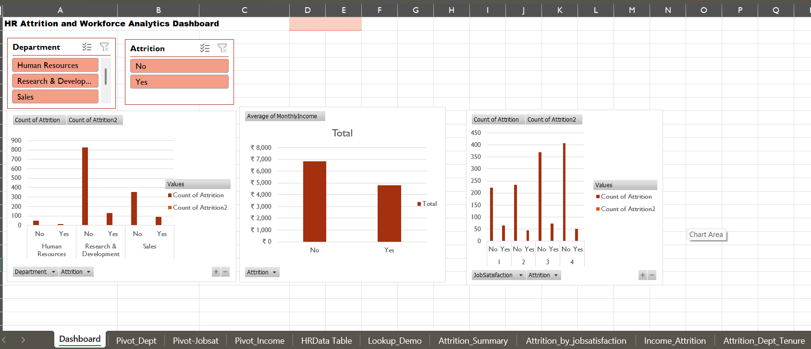

# HR Attrition & Workforce Analytics (Advanced Excel)

Analysis of the IBM HR Analytics Employee Attrition dataset (1,470 employees) to find which departments, satisfaction levels and tenure bands drive attrition.

## Dashboard

## Tools & Techniques
- Data cleaning and Excel Tables
- IFS to create tenure bands (0-2, 3-5, 5+ years)
- XLOOKUP and INDEX-MATCH for lookups
- COUNTIFS, SUMIFS and AVERAGEIFS for attrition summaries
- Goal Seek what-if analysis
- 3 Pivot Tables and an interactive Dashboard with slicers (Department, Attrition)

## Key Findings
- *Department:* Sales has the highest attrition rate (20.63%), followed by Human Resources (19.05%) and Research & Development (13.84%).
- *Job satisfaction:* Attrition falls from 22.84% at satisfaction level 1 to 11.33% at level 4.
- *Income:* Employees who left earned ₹4,787 per month on average, against ₹6,833 for those who stayed. Satisfaction shows a stronger link to attrition than income does.
- *Tenure:* Attrition is highest in the 0-2 year band in every department (Sales 34.95%, Human Resources 46.15%).

## Recommendation
Focus retention efforts on employees in their first two years, especially those with low job satisfaction scores.

## Files
- HR_Attrition_Analysis.xlsx - full workbook with formulas, pivot tables and dashboard
- HR_Attrition_cleaned.csv - cleaned dataset
- dashboard.png - dashboard screenshot

## Dataset
IBM HR Analytics Employee Attrition & Performance (Kaggle)
